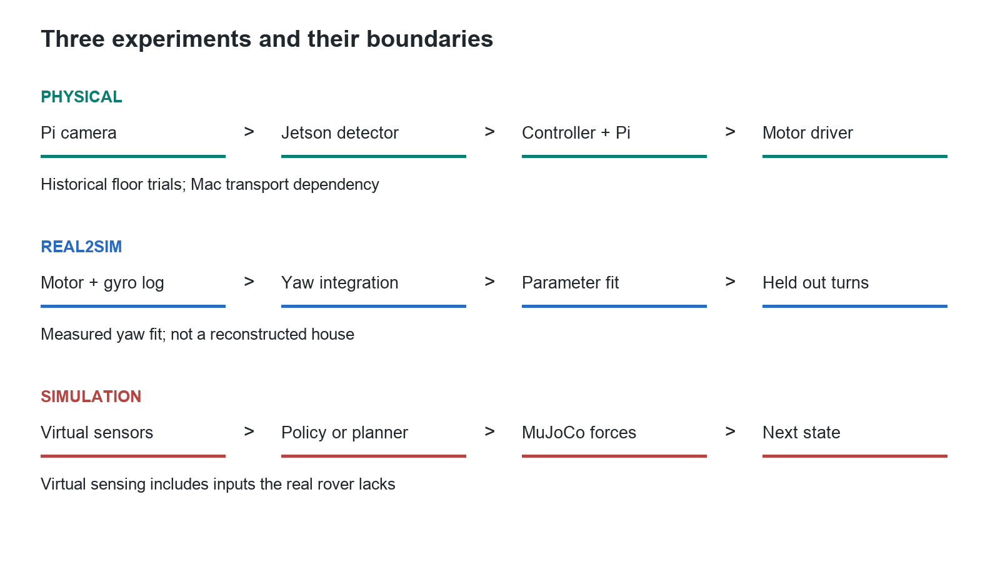
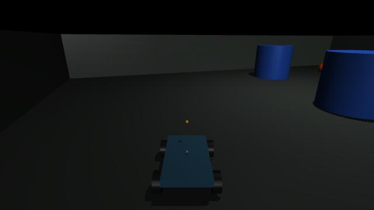
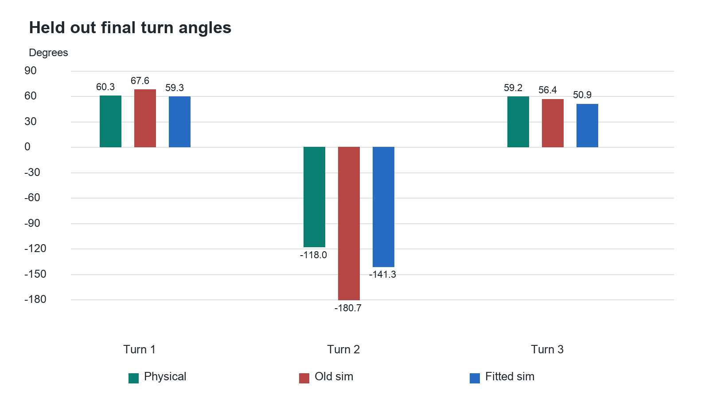
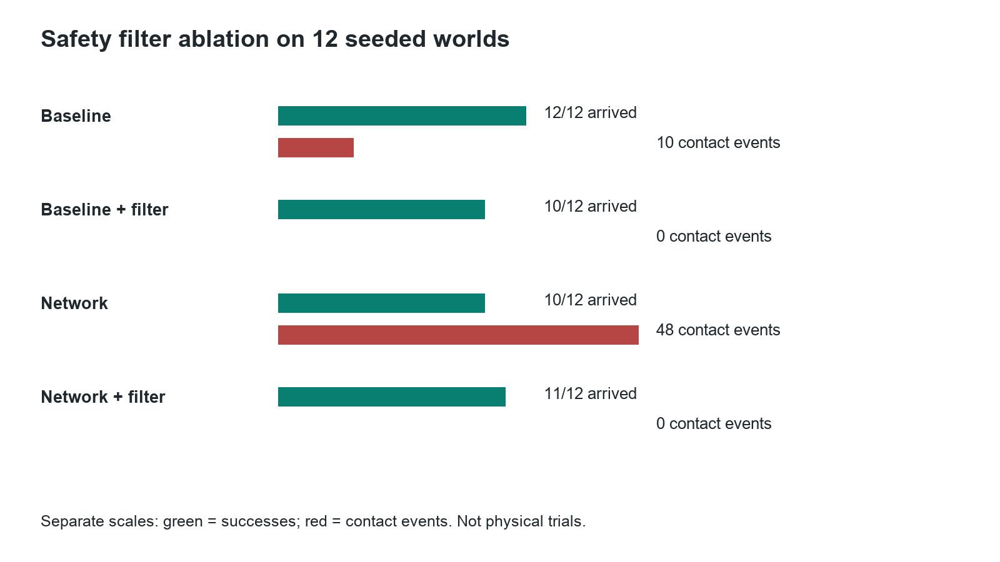

# Frontier Rover Machine Vision and Simulation Field Guide

## Purpose and first step

This guide is for Jack Coleman, a software engineer learning physical robotics through a four-wheel Raspberry Pi and Jetson rover. It explains the system we built, the numerical transformations inside it, what the evidence supports, and what to practise next. It is not a claim that reading a manual creates expertise. Expertise comes from predicting an outcome, running an experiment, explaining the discrepancy, and reproducing the result without assistance.

Your best next project is to turn this prototype into a reproducible perception and simulation case study. Do not buy another robot immediately. First understand and reproduce this one. Work through camera geometry and detector evaluation, then through the simulator and its calibration. Keep a short experiment notebook containing a prediction, a change, a result, and an explanation. An engineering result with retained failures is more credible than a polished animation with no measurements.

Take the Jetson Orin Nano developer kit, its existing SD card, its proper barrel power supply and mains lead, Camera Module 3, the ribbon that already worked on that Jetson, and the USB data cable used with your Mac. Protect the camera lens, ribbon ends and exposed boards during travel. The Pi is not required for the next laptop and Jetson lessons. You do not need to remove the soldered MPU or motor drivers. Keep the working Jetson installation; do not reflash it just to follow a newer tutorial. The camera previously worked on it according to your own hardware test. A fresh capture after travel is still a separate acceptance step.

The Mac can run the simulations and training of our small navigation network. The Jetson provides an NVIDIA deployment target: camera capture on embedded Linux, CUDA execution, TensorRT optimisation, and measurement under device power and thermal constraints. A capable laptop can also perform machine vision; the Jetson is useful because it is the intended embedded execution environment, not because laptops cannot recognise objects.

## How to use the offline pack

Read this document in chapter order. Open `Open Workbook.command` for the interactive companion. It runs without the internet, Pi or Jetson. Its geometry and weight exercises are classroom calculations; its network inspector uses our saved 386-parameter model; its replay displays recorded MuJoCo results. None of those buttons operates real motors.

Open `Run Simulation.command` to start the actual Python and MuJoCo lab on this Mac at port 8781. That is a separate operation from opening a saved replay. This launcher deliberately points physical-device URLs to an unused loopback port, so it cannot reach the rover or Jetson. The copied Python environment requires this Mac's bundled Python runtime; it does not require the original rover checkout. The Word document and workbook do not require Python at all. Keep the entire learning folder together so its relative links continue to work.

The `project` subfolder contains a source and evidence copy. `private` contains local-only camera material and old provisioning files; it is not a public GitHub upload. The old multi-gigabyte OS image is excluded because it is rebuildable installation media, not our measurements or model. The backup record distinguishes this exclusion from source that was successfully pushed.

## The system in three experiments

The rover was not one end-to-end learned brain. Three different experiments share some interfaces.

| Experiment | What consumes what | What was demonstrated |
| --- | --- | --- |
| Physical target approach | Camera pixels become a target box; explicit control logic becomes motor commands | Historical mandarin approach, reacquisition and arrival with zero output afterwards |
| Measured Real2Sim | Physical motor commands and gyro samples constrain simulator parameters | Directional yaw fitting and three held-out final-turn endpoints |
| Simulated navigation | Nine numerical observations enter a learned policy or baseline controller | MuJoCo contact-world evaluation, safety filtering and separate mapping experiments |

The pretrained image detector is not the small navigation network. Collecting lemon photographs did not train a lemon model. The navigation network does not consume camera images. The rendered-camera mapping experiment uses colour processing, not the physical YOLO detector. These distinctions determine which claim you can make in an interview.



The real control path was camera light to Pi camera capture, JPEG over HTTP to Jetson, TensorRT detection, explicit target controller, HTTP motor request, Pi validation and watchdog, GPIO signals, TB6612 motor driver, battery current, and wheel motion. The next image and gyro sample close the loop. The Mac hosted the lab and an SSH forwarding path used by the Jetson to reach the Pi. That dependency means we did not finish an independently operating onboard system.

The physical Pi is now out of service. Removing the GPIO harness and camera and trying a verified official recovery card did not produce the expected green ACT signal. That supports suspected hardware or power-delivery failure, not a verified cause or proof that the Belkin damaged it. The saved software and experiments remain valid historical evidence.

## Networking and deployment without the mystery

Think of each network layer as a different question. Power and boot ask whether the computer can execute anything. Wi-Fi association asks whether the radio joined the access point. DHCP asks whether it received an IP address. Routing asks which interface carries a packet. TCP asks whether a connection to a port succeeds. SSH adds authentication and an encrypted command channel. HTTP carries the browser controller and camera requests. A failure at one layer does not prove all the others failed.

The browser loaded HTML, CSS and JavaScript served by Python on the Pi at port 8765. A controller button sent a request; the Python process decided whether to accept it and set outputs. Closing the browser did not stop Linux or the Python service. Motion had to expire independently when the browser stopped refreshing commands. That is why the Pi watchdog belongs below the browser and autonomy service.

Editing code on the Mac changed only the development copy. Deployment copied the relevant Python or UI files to the Pi or Jetson, usually over SSH, and restarted the relevant service when required. Git saved versions; GitHub held remote commits. Neither a local edit nor a local commit updated hardware automatically. Conversely, a file edited on a device could differ from the Mac's source until deliberately reconciled.

One earlier network problem involved file permissions on generated Networkd configuration. Another involved macOS Local Network permission for the application executing commands. Those explain why different processes could disagree about reachability. They do not explain every later outage. The evidence also includes filesystem inconsistencies after repeated offline SD changes. Read-only inspection, a repair and a clean boot are different operations; a script printing success is not by itself proof of a working network.

The final failure is different: the recovery program is supposed to execute before Ubuntu and does not start Wi-Fi. No green recovery indication on an isolated board cannot be fixed by another Wi-Fi password edit. This is fault isolation: choose a test that removes whole software layers from the hypothesis rather than repeatedly changing settings.

An SSH tunnel forwards a particular port, not all connectivity. In our development path, a Jetson-local port could carry requests through the Mac to the Pi. A Mac sleeping, losing its network, or closing that tunnel could therefore break autonomy transport even if the Pi remained powered. This architectural dependency is distinct from a Pi failing to boot.

Clean shutdown lets Linux stop services and flush buffered filesystem updates before power disappears. The red LED can stay on after shutdown because electrical power is still present. It is not evidence that the controller is still running. A shell prompt matters: a shutdown command must execute on the intended remote host, not accidentally in a local terminal after an SSH session ends.

Checkpoint: explain the difference between editing, committing, pushing, deploying and restarting. They operate on different copies or processes; none implies that the other four happened.

## A camera frame becomes numbers

A frame is already a picture: a rectangular array of pixel values. A 640 by 360 RGB image contains 691200 channel values. With eight bits per channel, each is an integer from 0 to 255. JPEG compresses that array; the receiver must decode it before numerical image processing. Channel order matters: OpenCV commonly decodes BGR, whereas our neural input is RGB.

The detector computes a class score and box coordinates. Drawing a rectangle is a later visualisation of those numbers, not the act of recognition. The detection class says which category resembles the image; it does not identify the exact physical object forever. Reacquisition can select a different orange object if the detector and target-selection logic lack identity tracking.

Our `tensorrt_yolo.py` rotates the received image, resizes it with preserved aspect ratio, pads it, changes channel order, converts to the engine's input type, and scales values. The engine expects a fixed NCHW tensor: batch, channel, height, width. Its output decoder recognises a feature dimension of 84 for the COCO detector: four box values plus 80 class scores. This particular output contract must not be assumed for every YOLO model or exported graph.

For an illustrative 640 by 360 frame letterboxed into 640 by 640, scale is 1 and vertical padding is 140 pixels. A predicted network-space centre at y=340 corresponds to original y=200 after subtracting padding. If the scale were 0.5, you would also divide by 0.5. Forgetting this inverse transformation produces systematically misplaced boxes even when the network itself is working.

```python
# Actual decoding pattern in software/jetson/tensorrt_yolo.py
x1 = (center_x - width / 2.0 - pad_x) / scale
y1 = (center_y - height / 2.0 - pad_y) / scale
x2 = (center_x + width / 2.0 - pad_x) / scale
y2 = (center_y + height / 2.0 - pad_y) / scale
```

Our geometry function clips those coordinates to the image and rejects boxes with nonpositive width or height. It calculates a centre error, area ratio and bottom-edge ratio. These are dimensionless features used by the controller, not a three-dimensional room position.

```python
# Actual calculations in software/jetson/yolo_perception.py
center_x = (x1 + x2) / 2.0
horizontal_error = (center_x - frame_width / 2) / (frame_width / 2)
area_ratio = ((x2 - x1) * (y2 - y1)) / (frame_width * frame_height)
bottom_edge_ratio = y2 / frame_height
```

For box (440,180) to (520,260) in a 640 by 360 frame, the centre is x=480; error is +0.5; area ratio is 0.02778; bottom-edge ratio is 0.72222. The +0.5 comes from pixels being normalised relative to the image centre. It is not a weight and not 0.5 degrees. A calibrated pinhole model could estimate bearing with `atan((center_x - cx) / fx)`, but that needs camera intrinsics. Our controller directly uses the normalised error.

Box area can increase as an object approaches, but also if a larger object is farther away. A near object may leave the lower image boundary. Consequently area and bottom-edge thresholds are proximity heuristics, not verified obstacle distance. That explains why a target approach can fail at close range without the recognition network having an obvious classification error.

Non-maximum suppression avoids treating several overlapping predictions as separate targets. It sorts candidates by confidence and rejects boxes that overlap a retained box too strongly. Intersection over union, or IoU, is intersection area divided by union area. Two 100 by 100 boxes shifted horizontally by 20 pixels overlap by 8000 pixels and have union 12000 pixels, so IoU is 0.667.

The orange fallback in our code thresholds hue, saturation and brightness, cleans the binary mask, then checks component size, shape and vertical position. Its `source="hsv"` label matters: this is colour processing, not a trained semantic recogniser. It can mistake another orange patch for a mandarin. A source label lets you diagnose which algorithm actually supplied the box.

Read next: Stanford's [convolutional network notes](https://cs231n.github.io/convolutional-networks/) for local filters and weight sharing; [OpenCV camera calibration](https://docs.opencv.org/4.13.0/dc/dbb/tutorial_py_calibration.html) for intrinsics and distortion. Apply the reading to our coordinate transforms rather than trying to memorise an entire course at once.

## What neural weights actually do

A weight is a stored coefficient in a computation. With input x=0.5 and weight w=0.2, prediction `w*x` is 0.1. It is not a textual rule. Changing w changes how strongly x affects the prediction. A bias adds an offset, allowing a nonzero response even when the input is zero.

For a desired output of 0.3, squared error is `(0.1-0.3)**2 = 0.04`. The derivative with respect to w is `2*(w*x-target)*x`, which is -0.2. A learning rate of 0.1 gives `w_new = 0.2 - 0.1*(-0.2) = 0.22`. The new prediction is 0.11 and the new loss is 0.0361. The negative derivative means increasing this weight locally decreases this loss.

```python
# Complete scalar teaching step, not the deployed detector
x, target, weight, rate = 0.5, 0.3, 0.2, 0.1
prediction = weight * x
loss = (prediction - target) ** 2
gradient = 2 * (prediction - target) * x
weight -= rate * gradient
print(weight, (weight * x - target) ** 2)
```

Backpropagation applies this same derivative reasoning through many connected operations. For a tanh activation, the local derivative is `1 - activation**2`. The chain rule multiplies local derivatives along a path and adds contributions where paths merge. An optimiser applies the computed gradients. Our navigation training uses Adam, which maintains moving averages of gradients and their squares; the scalar workbook uses plain gradient descent so every arithmetic step is visible.

Convolutional image networks share small filters across image positions. A filter multiplies a local pixel patch by learned coefficients and sums the products. An illustrative 3 by 3 patch with a bright right column gives response 3 to a filter whose three rows are [-1,0,1]. The same filter can respond to that brightness transition elsewhere. Deeper filters combine earlier responses. They need not each have an interpretable human label.

The saved navigation model is much smaller and consumes no pixels. Its actual forward pass is:

```python
# software/sim/mlp_policy.py
hidden = numpy.tanh(inputs @ self.w1 + self.b1)
output = numpy.tanh(hidden @ self.w2 + self.b2)
```

Nine inputs connect to 32 hidden activations, then to two outputs. There are `9*32 + 32 + 32*2 + 2 = 386` trainable values. The nine inputs describe goal distance, goal bearing error, front/left/right clearance, forward velocity, yaw rate, contact and stuck status. Values are normalised by explicit environment constants. The two outputs request forward and turn effort.

Our gradient exercise loads the real saved model but modifies only a copy in memory. On its fixed classroom observation, it finds the derivative of weight `w1[3,16]` analytically and by finite differences. Both are approximately -0.05593739. Finite differences deliberately perturb the weight up and down by a tiny amount and compare losses; agreement is evidence that the derivative implementation is correct.

With one teaching update to all parameters at learning rate 0.001, weighted loss changes from 0.00331952 to 0.00314818. This is one example, not proof of generalisation. The saved model hash remains unchanged. In the workbook, changing an observation tests inference sensitivity; it does not retrain any weights. The separate scalar training control does change its teaching weight.

```bash
# Run inside the learning pack's project folder
../runtime/.venv/bin/python software/learning/rover_workshop.py gradient
../runtime/.venv/bin/python software/learning/one_weight_training.py
```

Read [PyTorch automatic differentiation](https://docs.pytorch.org/tutorials/beginner/basics/autogradqs_tutorial.html), then reproduce the finite-difference check in our NumPy model. Understanding both an automatic library and a small explicit derivative implementation is stronger than merely repeating that training changes weights.

## Training a detector and testing it honestly

We used pretrained YOLO weights for real target detection. The synthetic AprilTag regression experiment and the simulated navigation model were separate trained models. The synthetic regressor maps a 96 by 160 grayscale image to one normalised horizontal error; its recorded validation was synthetic, not a real-camera detector acceptance test. Our collected lemon images and labels are useful unfinished dataset work, not evidence of a trained lemon detector.

A custom object can be trained, but a label name alone does not add visual knowledge. You need diverse labelled examples, negative images, independent evaluation, and a model/training procedure capable of representing the task. Repeated frames of one stationary object add less variation than different distances, lighting, backgrounds and partial occlusions. An unlabelled image containing the target must not silently be treated as a negative image.

Split by capture session, not adjacent frames. Put images that resemble one another strongly into the same split. Training data adjusts weights; validation guides design decisions; the final test remains untouched until evaluation. If you repeatedly tune using the test set, it has become another validation set. Keep another final holdout.

A detector label can encode class ID and normalised centre x, centre y, width and height. For our earlier 80 by 80 box centred at (480,220), these values are 0.75, 0.61111, 0.125 and 0.22222. That label states the desired output. A training loss compares predicted boxes and class scores with the labels; its gradients update feature extraction and prediction layers.

The next custom-detector exercise is to label a small, varied object dataset, freeze session-based splits, fine-tune from a pretrained detector, and compare with the unmodified baseline. Record model/version, random seed, image size, epochs, batch size, augmentation, weights hash and test split. The high-level API below is illustrative and requires a verified Ultralytics environment and actual labelled dataset; it is not a completed training run in this project.

```python
from ultralytics import YOLO

model = YOLO("yolov8n.pt")
model.train(data="dataset.yaml", epochs=30, imgsz=640, seed=7)
```

Evaluate the task you care about. Precision asks how many reported detections are correct. Recall asks how many real targets were found. If there are 8 true positives, 2 false positives and 4 missed targets, precision is 8/10=0.8 and recall is 8/12=0.667. Define the class match and IoU threshold used to count a true positive. mAP summarises ranked detection precision/recall, but a robotics mission also needs detection continuity, frame freshness and close-range behaviour.

Your experiment report should show false positives, missed targets, small versus large boxes, near versus far objects, and inference latency. Lowering confidence usually accepts more candidates, including more mistakes. A high confidence score is not automatically a calibrated probability of correctness. See [Ultralytics YOLOv8 documentation](https://docs.ultralytics.com/models/yolov8/) for its supported training/export interfaces; preserve the project's versioned environment when reproducing old results.

## What the Jetson and TensorRT do

The Jetson ran the detection and autonomy Python service. TensorRT executes an optimised representation of the detector on NVIDIA hardware. It does not decide what the rover should do with a box. Our explicit mission/controller code makes that decision, and the Pi remains responsible for accepting and expiring motor commands.

An ONNX graph is an interchange representation of network operations and weights. A TensorRT engine contains selected execution strategies for an intended hardware/software environment. Building an engine is compilation and optimisation, not training. FP16 changes numerical precision and can change predictions slightly; validate output agreement and task accuracy as well as speed. An engine file is not assumed portable between every GPU or TensorRT version.

Our implementation allocates input and output buffers, binds their addresses, queues work on a CUDA stream, retrieves results and synchronises before interpreting them. A GPU can still be working after an asynchronous call returns. Timing only the call can therefore report dispatch overhead instead of computation time. Warm-up can include initialisation, allocation, cache effects and other one-time work; it should not be simplistically attributed only to CPU/GPU transfer.

Distinguish frame capture time, HTTP transfer, JPEG decode, resize/normalisation, inference, decoding/NMS, control calculation and motor transport. The historical physical mission reported median perception pipeline time 53.63 ms and median action transport 20.57 ms. Those numbers describe that record, not guaranteed future throughput. A different probe measured a different total. Neither single inference latency nor a drawn FPS counter alone is an end-to-end control metric.

If a rover moves at an illustrative 0.4 m/s and the observation is 200 ms old, it has moved about 8 cm before acting on that observation, even before braking. That is why freshness checks and bounded motion matter. The camera-delivery issue also taught us that a stream reader's buffering can create old images even while the service responds. A successful HTTP status code is not evidence that the displayed image is current.

For your next Jetson experiment, preserve the working installation, process a fixed set of saved images, warm up, report median and 95th-percentile latency, and compare engine predictions with a reference. Then repeat on live camera frames with capture timestamps. See [TensorRT performance guidance](https://docs.nvidia.com/deeplearning/tensorrt/latest/performance/best-practices.html) for measurement methods. Do not copy generic benchmark numbers into your own results.

## Motor commands and the MPU

The controller's normalised forward and turn values are requests, not measured speed. The mixer combines them into two signed side commands. A positive right-turn request increases the left side and decreases the right side in our convention. Scaling prevents the mixed commands exceeding magnitude 1. Side calibration then compensates an observed imbalance.

```python
left = forward + turn
right = forward - turn
scale = max(1.0, abs(left), abs(right))
left_pwm = left / scale * left_calibration
right_pwm = right / scale * right_calibration
```

For forward=0 and turn=0.3 with left calibration 0.8 and right 1.0, the signed values are +0.24 and -0.30. The signs select electrical direction. PWM, pulse-width modulation, rapidly switches the driver command on and off: 60% means active for 60% of each PWM cycle. It does not mean 60% of maximum measured velocity, and the left/right percentages do not have to sum to 100. Both can be 60%.

The TB6612 is an H-bridge motor driver: switching transistors apply battery voltage across the motor in either polarity. The GPIO signals control those switches; the separate motor battery supplies the motor current. VM is the motor supply and VCC is the driver's logic supply. They are not interchangeable. Bad joints, shorts, stiction, load, battery voltage and gear friction can make the same command produce different motion. Software trim can compensate a repeatable mismatch, not repair a loose joint.

Three time scales were easy to confuse: the electrical PWM frequency, the software command/watchdog interval, and the much slower visible stop-start mission pulses. Smooth PWM still permits a jerky mission if its high-level planner repeatedly stops to acquire a fresh frame. Removing all pauses without fixing latency and braking distance can make overshoot worse.

The MPU breakout contains microscopic electromechanical sensors. An accelerometer senses displacement of a tiny suspended mass, commonly through changing capacitance. A vibrating gyroscope senses motion-dependent forces caused by rotation; electronics convert that signal into angular-rate readings. Its registers provide numbers over I2C. It is not sensing wheel angle or directly measuring a room position.

A stationary accelerometer measures support against gravity, so a nonzero reading is expected even while the rover is still. A gyroscope ideally reads zero angular rate at rest, but bias and noise remain. We estimate stationary bias, subtract it and integrate rate over elapsed time. A persistent 0.2 degree/s error accumulates to 12 degrees after one minute.

Our MPU was rigidly mounted vertically, so sensor Y, not an assumed sensor Z, was identified as the chassis yaw axis. Vertical mounting is fine when the axis transform is known. Loose mounting measures sensor wobble as well as rover movement. A gyro helps correct turning and short straight-line heading; it does not provide reliable long-distance translation from simple acceleration integration. Wheel encoders or a suitable visual/range method are still needed for metric motion estimates.

The closed-loop turn controller repeatedly compared desired rotation with integrated gyro rotation and adjusted effort. That is feedback: the next output depends on a measured result, not merely on how long the motor was commanded. The recorded three-turn test's maximum controller error was about 2.02 degrees. This differs from the simulator's prediction error for the same test, which was larger.

## What our simulation actually calculates

MuJoCo is the physics engine. Our Python code defines the experiment and control loop around it. The XML defines a chassis, four wheel bodies, joints, actuators, a ground plane and sensors. The engine advances positions and velocities while calculating effects of forces, inertia, constraints and contacts. The browser draws or replays results; it does not create the physical dynamics merely by animating a rover icon.

```xml
<!-- Actual model settings in simulation/frontier_rover.xml -->
<option timestep="0.002" integrator="implicitfast"
        gravity="0 0 -9.81"/>
<geom name="chassis" type="box"
      size="0.128 0.075 0.012" mass="0.8"/>
```

The model therefore does include mass, gravity and friction. The problem is not that it represents an ideal weightless world. The problem is that many values are assumptions rather than measurements of our assembled rover. Chassis mass 0.8 kg and wheel radius 0.0325 m are model choices, not established physical measurements. A detailed engine can accurately solve the wrong model.

Our simple actuator uses a drive-dependent gain and a velocity-dependent term. That approximates the way available motor effort falls with speed. It does not explicitly reproduce every battery, gearbox, electrical current, wire-contact, deadband or thermal effect. The model has wheel-floor contacts, but the fitted effective yaw gain can absorb errors from several physical sources. Do not interpret it as a uniquely measured motor constant.

```python
# Actual structure in software/sim/mujoco_rover.py
self.set_action(forward, turn)
target_time = self.data.time + duration_s
while self.data.time < target_time:
    mujoco.mj_step(self.model, self.data)
return self.observe()
```

An action sets actuator controls; the engine integrates many small timesteps; sensors and body state provide the new observation. A high-level control period of about 50 ms contains many 2 ms physics steps. Always inspect recorded timestamps: numerical stepping and loop conditions can make actual elapsed increments differ slightly from the requested control period. Unit and timing mismatches are simulator bugs, not learning problems.

The Gymnasium environment wraps reset and step. Reset chooses a seeded scenario and initial state. Step takes a two-number action and returns an observation, reward, termination flags and diagnostics. This interface makes policies exchangeable and experiments reproducible. It is not itself a physics engine or an algorithm that trains weights.



The scene above is generated from our MuJoCo model. It is not your house and not a photograph of the real rover. The offline workbook retains both predetermined scenarios 0 and 1 with seed 9201, including timeouts. Changing its replay slider selects a recorded state. Running the full lab or an experiment script invokes the engine again and can produce different results when parameters change.

Read the [MuJoCo overview](https://mujoco.readthedocs.io/en/stable/overview.html) alongside the XML and `RoverSimulation.step`. Your first explanation should trace those actual functions, not list simulation product names.

## Real2Sim is an identification experiment

Real2Sim here means identifying dynamics parameters from physical measurements. We recorded motor commands and 530 gyro samples, estimated stationary bias, selected sensor Y for yaw, integrated the measured rate and compared the resulting turn trajectories with simulation under corresponding actions. The fitted parameters were left-turn gain, right-turn gain and velocity feedback.

The fit produced gains 0.90 and 0.84 and feedback 0.004. On the fitting trace, angle RMSE was about 2.33 degrees. That is training/calibration error. A different physical sequence, +60, -120, +60 degrees, was then used to compare final turn endpoints. That distinction prevents us from calling a fit to its own data proof of predictive accuracy.



| Turn | Physical angle | Old simulation | Fitted simulation |
| --- | --- | --- | --- |
| 1 | 60.33 degrees | 67.64 degrees | 59.27 degrees |
| 2 | -117.98 degrees | -180.72 degrees | -141.33 degrees |
| 3 | 59.24 degrees | 56.39 degrees | 50.85 degrees |

The endpoint RMSE decreased from 36.51 to 14.34 degrees, a 60.7% reduction. The remaining error on turn 2 was about 23.36 degrees. That is evidence of improvement and also evidence that the model is not fully accurate. The reported validation metric covers three final angles, not every sample of every trajectory and not x/y position accuracy.

```python
# The definition used to interpret endpoint error
errors = simulated_angles - measured_angles
rmse = numpy.sqrt(numpy.mean(errors ** 2))
```

Good identification experiments excite the behaviour you need to predict. Turn-only data cannot establish straight-line speed, stopping distance or battery sag. A stronger next dataset would contain repeated forward speeds, reversals, stops, turns in both directions and different loads, with independent position or wheel measurements. Hold out entire manoeuvres. Fit on one set, then ask whether the frozen model predicts the other set better than a baseline.

Parameter identifiability matters. Different combinations of friction and actuator gain can yield a similar yaw trace. One good fit does not prove either parameter equals the true physical value. Measure what you can directly, fit a small justified subset, plot residuals, and report confidence or plausible ranges instead of pretending all values are known. The [MIT system identification chapter](https://underactuated.mit.edu/sysid.html) develops this idea; connect it to our directional-turn fit first.

Domain randomisation samples parameters across many runs, such as friction, side gains, sensor noise and latency. It teaches robustness to a family of conditions. Its ranges are hypotheses until supported by measurements. Randomising arbitrary numbers does not turn a simulator into reality. More visual detail is also not a substitute for correctly modelled observations and actuation.

## Learned navigation and what actually improved

Our training first collected observation/action pairs from a deterministic baseline policy in simulated worlds. Behaviour cloning then adjusted the small network to imitate those actions. During two Dataset Aggregation rounds, or DAgger rounds, the learner visited states and the baseline supplied labels at those states. This addresses the fact that learner mistakes can carry it into situations absent from the original demonstrations. The retained training report contains 29380 samples.

Training used supervised action error, not reinforcement learning. The environment's reward scored progress, contacts and arrival, but did not drive the weight updates in this experiment. Saying there was a reward in the environment is not evidence of RL training. A model can imitate a flawed teacher; that is why closed-loop evaluation is more important than validation action loss alone.

A safety filter wraps the proposed action. It can slow, reverse or pivot based on front/side clearance, contact and stuck flags. It has memory, including recovery timers. That memory belongs to explicit software, not to the feed-forward neural network. The physical Pi watchdog is a different safety mechanism: it expires stale commands, regardless of whether a high-level policy is learned or hand-written.

The original 40-world result was 33 successes and no contact episodes for the learned policy plus filter, versus 32 successes and 36 contact episodes for the baseline without that filter. This comparison changed two things at once: policy and filter. It does not isolate the benefit of learning.



The later 12-world comparison separated the filter within each policy family. Baseline alone achieved 12 successes with 10 contact events; baseline plus filter 10 with zero; bounded network alone 10 with 48; network plus filter 11 with zero. The filter clearly matters in this test. The small sample and remaining action-bound differences prevent a sweeping conclusion that one architecture is superior. Event counts are not the same as counts of missions with any contact.

The network's input vector includes modelled noisy speed, gyro and range, but its contact and stuck flags still involve simulator state. Our physical rover lacked the corresponding metric range and wheel-speed observations. Copying the weights to Jetson could execute the network; it would not establish valid Sim2Real transfer. Interface parity requires the same meanings, units, sign conventions, timing, bounds and failure handling on both sides.

Read the original [DAgger paper](https://proceedings.mlr.press/v15/ross11a.html) after tracing the data aggregation in our training script. The practical question is: which states did the learner visit that the first dataset missed, and did the new labels reduce failures on untouched worlds?

## Mapping is not object detection

Object detection says that an image region resembles a target. Localisation estimates where the rover is. Mapping estimates which parts of the environment are occupied or free. Planning selects a route through that belief. These are separate computations; seeing an orange once does not automatically give a map or a reliable route around furniture.

Our simulated exploration stack casts 41 MuJoCo geometry rays across 200 degrees, corrupts/delays their distances, integrates noisy speed and gyro into an estimated pose, updates a log-odds occupancy grid, chooses a frontier or remembered target, uses A* to find a path, and tracks it. A frontier is a boundary of known free and unknown space. Obstacle inflation accounts for chassis width so a point path does not pass the rover body through an obstacle.

A ray marks traversed cells as evidence of free space and its hit endpoint as evidence of occupancy. Log-odds representation allows those increments to be accumulated. Pose error moves the evidence into the wrong cells; a convincing-looking map can therefore be wrong. The simulator retains true pose separately so we can quantify that error.

Our rendered-camera mapping benchmark completed 10 of 12 trials. Its canonical run arrived in 33.932 simulated seconds with zero contacts and final pose error 0.4303 m. These figures describe a simulated sensor model and virtual environment. They do not establish a physical house map, SLAM, or a rover capable of searching the entire house for a hidden object.

For physical mapping, metric scale and repeatable motion observations are the missing issue. Monocular image motion can give useful constraints but does not automatically provide absolute distance. Our ORB feature matching and RANSAC check demonstrated pixel-motion estimation on saved frames, not a calibrated metric trajectory. A future stereo/depth/range or properly constrained visual-inertial setup must be evaluated, not assumed to solve this merely because a library runs.

## Your first four weeks overseas

Spend the first session explaining one frame all the way to one motor request. Open the geometry exercise, calculate the +0.5 example on paper, then read `measure_box`, `TargetController.update`, `plan_execution` and the mixer. Predict stale-frame and target-loss behaviour before running the examples. Save a one-page diagram with units on every connection.

In week one, make a perception evaluation report from saved and new camera frames. Annotate an independent set, compare predictions at several confidence thresholds, show misses and false positives, and plot near/far performance. Then measure the actual Jetson pipeline with warm-up and end-to-end timestamps. Deliverable: a reproducible report that explains at least three failures, not just bounding boxes on a video.

In week two, trace one simulation step and run paired parameter experiments. Change one of side gain, command delay, friction or odometry scale while keeping the scenario seed fixed. Compare position, heading, contacts, elapsed time and requested versus executed actions. Explain why a replay slider is not a new experiment. Deliverable: a figure linking one parameter change to a measurable behavioural change.

In week three, reproduce the saved model's gradient check. Train a separate navigation model without overwriting the accepted artifact. Compare learning curves and held-out closed-loop outcomes. Repeat a baseline/filter/network/filter factorial comparison. Deliverable: a result that can distinguish a learning improvement from a safety-wrapper improvement. Do not tune repeatedly on your final test seeds.

In week four, improve one explicitly documented model assumption. With no working rover, you cannot collect new rover-ground-truth data; instead analyse identifiability and residuals in the saved turning records, or collect a new camera-calibration dataset using Jetson. Write a transfer specification listing every physical observation needed by the policy. Deliverable: an honest plan that says exactly which measurement would allow a new physical acceptance test.

Only after those results should you expand into C++ integration, ROS 2, Isaac Lab or a new robot. C++ is useful for native APIs, bounded latency and systems integration; ROS 2 offers standard communications and tooling; Isaac Lab offers another simulation/training environment. None substitutes for coordinate frames, sensor timing, calibration, held-out evaluation and hardware-safe interfaces. Our project did not implement ROS 2 or Isaac Lab, and should not claim it did.

## Runnable exercises and answer key

Run these from the learning pack's `project` directory. They do not contact hardware. New output filenames preserve earlier experiment results.

```bash
../runtime/.venv/bin/python software/learning/rover_workshop.py vision
../runtime/.venv/bin/python software/learning/rover_workshop.py vision --lost
../runtime/.venv/bin/python software/learning/rover_workshop.py gradient
../runtime/.venv/bin/python software/sim/run_mujoco.py --forward 0.4 --seconds 1
```

For a new four-way simulation comparison, use a new filename and a seed you record before examining the output:

```bash
../runtime/.venv/bin/python software/learning/rover_workshop.py compare \
  --episodes 4 --seed 270001 --output learning-output/my-comparison.json
```

Exercise 1: move the box centre from x=480 to x=160 in a 640-pixel image. Answer: error changes from +0.5 to -0.5. The measured geometry changes sign; the controller's convention determines which side speeds up. This is not a change to detector weights.

Exercise 2: increase both wheel commands from 0.6 to 0.8. Answer: requested electrical duty increases, not necessarily measured speed by one third. Motor load, deadband, supply and friction intervene. A speed claim requires a speed measurement.

Exercise 3: double the scalar training learning rate. Answer: the first step is larger, but loss does not decrease for every possible rate. For a sufficiently aggressive rate, the update overshoots the minimum and may diverge. A learning-rate slider is not a wheel-speed control.

Exercise 4: explain why a low fitting error and a large held-out error can coexist. Answer: the fit may capture only the manoeuvres it saw, exploit unidentifiable parameters or absorb noise. Our 2.33-degree fitting-trajectory error and 14.34-degree held-out endpoint error also use different evaluation samples and metrics.

Exercise 5: remove the safety filter and inspect contacts. Answer: the proposed neural action and the final executed action need not be the same. Our saved ablation shows that the filter accounts for much of the contact reduction. A neural policy should not receive credit for a safeguard implemented elsewhere.

Exercise 6: can the rover find a hidden object anywhere in a house? Answer: not demonstrated. Simulated exploration and bounded physical visual reacquisition are different results. Physical metric localisation, obstacle sensing and mapping acceptance remain unfinished.

Exercise 7: what is lost when the original repo folder is deleted? Answer: only copies that have not been pushed or separately preserved. This pack contains its own code, evidence and runtime copy. GitHub intentionally excludes private photos, old credentials and OS images. Read the backup record before deletion; no repo is deleted automatically.

## Source map for explaining the code

| Question | Start in this project file |
| --- | --- |
| How do pixels become a target box | `software/jetson/tensorrt_yolo.py` |
| Where does normalised error come from | `software/jetson/yolo_perception.py` |
| Why align approach search or stop | `software/jetson/autonomy_controller.py` and `mission_runtime.py` |
| Who expires motor commands | `software/pi/remote_control.py` |
| How do gyro readings become a turn | `software/pi/imu.py` and `closed_loop_turn.py` |
| What physical model is integrated | `simulation/frontier_rover.xml` and `software/sim/mujoco_rover.py` |
| Which observations reach the policy | `software/sim/high_fidelity_env.py` |
| How do weights change | `software/sim/mlp_policy.py` |
| How was simulation fitted | `software/sim/fit_imu_turn_dynamics.py` |
| How does mapping work | `software/shared/grid_mapping.py` and `software/sim/exploration_scenario.py` |

## Portfolio explanation you can defend

I built a Pi and Jetson rover with camera streaming, TensorRT target perception, watchdog-bounded motor control and gyro-controlled turns. I separately modelled a four-wheel rover in MuJoCo, fitted directional yaw dynamics from physical telemetry, and evaluated navigation policies with delayed and noisy observations. I retained failures and checked the contribution of the safety filter. The real turning fit reduced error across three held-out final-angle endpoints from 36.51 to 14.34 degrees. Simulated mapping and policy learning were implemented, but physical metric mapping and learned-policy transfer were not completed.

Use this description only when you can open the associated code and explain one measurement from each claim. The learning objective is not to sound fluent in framework names. It is to show how an input becomes an output, what assumptions make the calculation meaningful, and which experiment tells you when those assumptions fail.

## Primary readings in a useful order

External links require the internet. The explanations, exercises, code copy and saved figures in this pack do not. These are reading assignments, not downloaded copies of external textbooks.

1. [Stanford CS231n convolutional networks](https://cs231n.github.io/convolutional-networks/). Explain one shared filter and distinguish features from predicted boxes.
2. [OpenCV camera calibration](https://docs.opencv.org/4.13.0/dc/dbb/tutorial_py_calibration.html). Explain focal length in pixels, principal point and distortion before estimating a bearing.
3. [PyTorch automatic differentiation](https://docs.pytorch.org/tutorials/beginner/basics/autogradqs_tutorial.html). Derive our scalar gradient and validate one network derivative numerically.
4. [Ultralytics YOLOv8](https://docs.ultralytics.com/models/yolov8/). Trace train, predict and export as different operations; inspect the output contract of your actual engine.
5. [NVIDIA TensorRT performance guidance](https://docs.nvidia.com/deeplearning/tensorrt/latest/performance/best-practices.html). Separate warm-up, synchronisation, throughput and latency in your benchmark.
6. [MuJoCo overview](https://mujoco.readthedocs.io/en/stable/overview.html). Map model, data, forces, contacts and integration to our XML and step loop.
7. [MIT Underactuated Robotics system identification](https://underactuated.mit.edu/sysid.html). Explain why a parameter fit can improve predictions without identifying unique physical constants.
8. [Ross and colleagues on DAgger](https://proceedings.mlr.press/v15/ross11a.html). Explain why a learner needs labels at the states its own errors cause it to visit.

For deeper project history, the copied `docs/learning-guide.md`, `docs/rover-practical-course.md`, `docs/simulation-and-sim2real-course.md` and dated experiment notes are included. This field guide is the current starting point and overrides older present-tense descriptions of the physical rover being operational.
